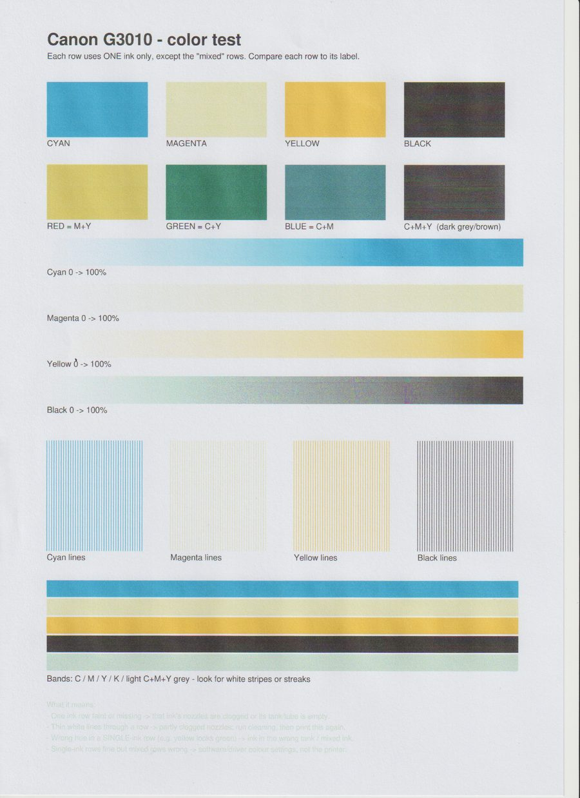
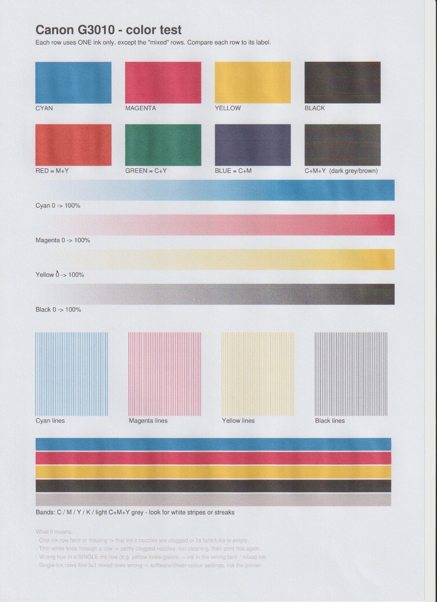

# canon-ij-maint

Run print-head cleaning, **deep cleaning** and nozzle checks on Canon PIXMA inkjets from Linux,
without installing Canon's driver.

Canon's official Linux driver (`cnijfilter2`) only offers a regular cleaning and a nozzle check.
Deep cleaning is normally only available from Canon's Windows/macOS tools or the printer's own
buttons, and many owners never find the right button sequence. This tool sends the same commands
Canon's driver sends, plus the deep cleaning variant.

Website: <https://nizarmah.com/canon-ij-maint/>

## Install

```bash
pipx install git+https://github.com/nizarmah/canon-ij-maint
```

Or just download the single file. It has no dependencies:

```bash
curl -fsSLO https://raw.githubusercontent.com/nizarmah/canon-ij-maint/main/canon_ij_maint.py
python3 canon_ij_maint.py list
```

## Quick start

The examples use `python3 canon_ij_maint.py`. With pipx, just run `canon-ij-maint`.

```bash
# list Canon printers this machine knows about
python3 canon_ij_maint.py list

# regular cleaning
python3 canon_ij_maint.py --queue YOUR_QUEUE clean

# deep cleaning (uses a lot more ink; let the printer rest ~10 minutes afterwards)
python3 canon_ij_maint.py --queue YOUR_QUEUE clean --deep

# print the nozzle check pattern
python3 canon_ij_maint.py --queue YOUR_QUEUE nozzle-check
```

The destination can be:

- `--queue NAME`: any CUPS queue pointing at the printer. The bytes go through `lp -o raw`, so
  the queue's driver doesn't matter.
- `--device /dev/usb/lp0`: write straight to the USB printer device (needs write access, usually
  the `lp` group).
- `--output FILE`: just save the bytes (`-` for stdout), e.g. to inspect them or send them another way.

If you give none and there is exactly one Canon CUPS queue, it uses that.

## Tested printers

| Printer | Regular clean | Deep clean | Nozzle check |
|---|---|---|---|
| PIXMA G3010 (USB) | works | works (`--group all`) | works |

All three commands are byte-for-byte identical to what Canon's own `cmdtocanonij3` filter sends.

On our G3010, magenta had stopped printing entirely, with plenty of ink in the tank. Two regular
cleanings did nothing. One deep cleaning, followed by a 10-minute rest, brought it back fully.

| Before | After one deep clean |
|---|---|
|  |  |

Unedited 150 dpi scans of the same test page, from the G3010's own scanner.

On the G3010, `--group color` deep cleaning is **ignored** (no sound, nothing happens). Use the
default `--group all`. `--group black` has not been tested.

Other recent PIXMA, MegaTank (G-series), TS and TR models that use Canon's `cnijfilter2` driver
probably speak the same protocol, but they're untested. If a command is ignored, the printer
simply stays silent; nothing harmful happens. Reports for other models are welcome.

## How it works

These printers accept "IVEC" XML commands on the print channel. Canon's `cmdtocanonij3` CUPS
filter frames each maintenance job as:

1. a `StartJob` message (`servicetype="maintenance"`),
2. as many zero bytes as that message is long,
3. the operation: `Cleaning` (`inkgroup` = all/black/color, `type` = regular/deep) or
   `TestPrint` (`type` = nozzle_check),
4. an `EndJob` message.

Canon's filter hard-codes `type=regular`. Changing it to `deep` triggers a deep cleaning.

The older Canon "BJL" commands (`@Cleaning=1ALL`, used by Gutenprint's `commandtocanon`) are
ignored by the G3010.

## Troubleshooting tips

- **Paper out:** after loading paper, press the printer's Black or Color button to resume.
- **One color missing after cleaning:** do a deep clean, wait 10 minutes, then print a test page.
  Repeat once if needed. If a color is still missing with ink in the tank, the print head is
  likely worn out (it's a replaceable part on MegaTank models).
- **Ubuntu auto-created queue:** on plug-in, Ubuntu may create a queue with a wrong driver
  (we saw an HP Designjet PostScript driver picked for a G3010). Delete it and add the printer
  with Gutenprint (`printer-driver-gutenprint`) or Canon's `cnijfilter2` driver.

## Not supported (yet)

- Ink flush / "system cleaning". Its command value is unknown.
- Reading ink levels or status back from the printer. That needs a two-way connection.

## License and disclaimer

MIT. Use at your own risk: cleaning cycles use ink and fill the printer's waste-ink absorber.

Not affiliated with or endorsed by Canon Inc. "Canon", "PIXMA" and "MegaTank" are trademarks
of Canon Inc., used here only to say which printers this tool works with.
